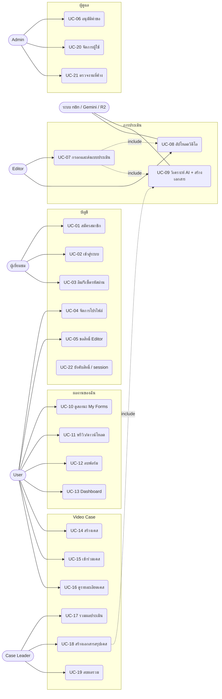

# VIA V4 — Use Cases

ระบบ **VIA (Video Intelligence & Analytics)** ใช้ส่งแบบประเมินวิดีโอ (rubric 9 หมวด / 45 ข้อ) ให้ AI วิเคราะห์ และสร้างเอกสาร PDF/DOCX

เอกสารนี้เขียนจาก `src/App.tsx`, `README.md`, `docs/figma-screen-map.md` และ `docs/direct-document-dispatch.md`

## Actors

| Actor | คำอธิบาย |
|---|---|
| ผู้เยี่ยมชม | ยังไม่ล็อกอิน |
| User | global role `user`: ดู dashboard, My Forms, เข้าร่วมเคสได้ แต่ส่งแบบประเมินไม่ได้ |
| Editor | global role `editor`: ทำได้เท่า User และส่งแบบประเมินได้ (`/form-submit`) |
| Admin | global role `admin`: ทำได้เท่า Editor และจัดการผู้ใช้ อนุมัติคำขอ และดูงานที่ค้าง |
| Case Leader | case role `leader` ในเคสหนึ่ง สามารถรวมและลบผลรวมของเคสนั้น (Admin ทำได้เช่นกัน) |
| Case Member | case role `member` อ่านผลของเคสได้อย่างเดียว |
| Supabase | Auth, Postgres (RLS), Storage, Edge Functions |
| Cloudflare R2 | เก็บวิดีโอที่อัปโหลด |
| n8n | รับงาน ประมวลผลวิดีโอ/AI สร้างเอกสาร แล้ว callback |
| Gemini | วิเคราะห์ AI และสรุปผลรวมของเคส |

> role ของ Leader/Member (ระดับเคส) แยกจาก global role และไม่ใช้แทนกัน

## Use Case Diagram

(Editor และ Admin ได้รับ use case ของ User ด้วย และ Admin ได้รับของ Editor และ Leader ด้วย แต่ไม่ได้วาดซ้ำเพื่อให้ diagram อ่านง่าย)

---

## กลุ่มบัญชี

### UC-01 สมัครสมาชิก
- **Actor**: ผู้เยี่ยมชม
- **Precondition**: ยังไม่มีบัญชี
- **Main flow**
  1. เปิดหน้า `/register`
  2. กรอก user ID, เลขพนักงาน, email, password และยืนยัน password
  3. กดสมัคร ระบบสร้างบัญชีผ่าน Supabase Auth
  4. ระบบแจ้งผลสำเร็จ (อาจรอยืนยัน email)
- **Alternate / Exception**
  - ข้อมูลไม่ครบหรือรูปแบบผิด: แสดง validation ไม่ส่งคำขอ
  - password ไม่ตรงกัน: แจ้ง error
  - email ซ้ำหรือ Auth ปฏิเสธ: แสดงข้อความผิดพลาด
- **Postcondition**: มีบัญชีใหม่ role เริ่มต้นเป็น `user`

### UC-02 เข้าสู่ระบบ
- **Actor**: ผู้เยี่ยมชม
- **Precondition**: มีบัญชีแล้ว
- **Main flow**
  1. เปิด `/` กรอก email และ password
  2. ระบบตรวจสอบผ่าน Supabase Auth
  3. ระบบนำไปหน้าตาม role: Admin ไป `/admin`, Editor ไป `/form-submit`, User ไป `/dashboard`
- **Alternate / Exception**
  - ข้อมูลผิด: แจ้ง invalid login
  - มี session อยู่แล้วและเปิด `/`: redirect ไป `/home`
- **Postcondition**: มี session ที่ใช้งานได้

### UC-03 ลืมและรีเซ็ตรหัสผ่าน
- **Actor**: ผู้เยี่ยมชม
- **Main flow**
  1. เปิด `/forgot-password` กรอก email
  2. ระบบส่งลิงก์ recovery โดยไม่เปิดเผยว่ามีบัญชีหรือไม่
  3. ผู้ใช้เปิดลิงก์ไป `/reset-password`
  4. ตั้งรหัสผ่านใหม่และยืนยัน
  5. กลับไปเข้าสู่ระบบด้วยรหัสใหม่
- **Alternate / Exception**: กดขอซ้ำเร็วเกินไป (cooldown), ลิงก์หมดอายุ, password ไม่ตรงกัน
- **Postcondition**: รหัสผ่านถูกเปลี่ยน

### UC-04 จัดการโปรไฟล์
- **Actor**: ผู้ใช้ที่ล็อกอิน (ทุก role)
- **Main flow**
  1. เปิด `/profile` ดูข้อมูล
  2. แก้ชื่อ-นามสกุล เลขพนักงาน เพศ และอัปโหลด/ตัด avatar
  3. บันทึก
  4. หรือกดออกจากระบบ
- **Alternate / Exception**: บันทึกไม่สำเร็จ แสดง error
- **Postcondition**: ข้อมูลโปรไฟล์ใน `user_information` ถูกอัปเดต

## กลุ่มสิทธิ์

### UC-05 ขอสิทธิ์ Editor
- **Actor**: User
- **Main flow**
  1. เปิด `/role-requests` ส่งคำขอสิทธิ์ editor
  2. ดูสถานะ pending / approved / rejected
  3. ยกเลิกคำขอที่ยังรอได้ (ผ่านหน้าต่างยืนยัน)
- **Alternate / Exception**: ผู้ใช้มีคำขอ pending ได้ครั้งละ 1 รายการ (unique index) ส่งซ้ำจะ error
- **Postcondition**: มีคำขอรอ Admin ตรวจ
- **หมายเหตุด้านความปลอดภัย**: ฝั่ง client และ RLS ไม่จำกัดค่า `requested_role` ผู้ใช้จึงยื่นขอ `admin` ได้ แต่ไม่ได้สิทธิ์เอง เพราะการอนุมัติต้องเป็น Admin และ trigger `guard_user_role_changes` ห้ามผู้ที่ไม่ใช่ admin/service_role เปลี่ยน role

### UC-06 ตรวจและอนุมัติคำขอสิทธิ์
- **Actor**: Admin
- **Main flow**
  1. เปิด `/role-requests` ดูรายการคำขอ
  2. อนุมัติหรือปฏิเสธ
- **Postcondition**: ถ้าอนุมัติ ผู้ขอได้สิทธิ์ editor

## กลุ่มการประเมิน

### UC-07 กรอกและส่งแบบประเมิน
- **Actor**: Editor, Admin
- **Precondition**: ล็อกอินและมีสิทธิ์ editor ขึ้นไป (route guard `requiredRole="editor"`)
- **Main flow**
  1. เปิด `/form-submit` (อาจผูกเคสผ่าน `?caseId=`)
  2. กรอกข้อมูลเคส ให้คะแนน rubric 9 หมวด 45 ข้อ และข้อเสนอแนะ
  3. เลือกโหมด data-only หรือ with-video
  4. ถ้ามีวิดีโอ ระบบทำ UC-08
  5. กดยืนยันส่ง ระบบบันทึก evaluation
  6. ระบบส่งงานให้ n8n ผ่าน Edge Function `forward-to-n8n` (UC-09)
  7. แสดงความคืบหน้าและผลสำเร็จ
- **Alternate / Exception**
  - กรอกไม่ครบ: validation
  - สิทธิ์ไม่พอ: redirect ตาม role
  - งานนี้ถูกส่งไปแล้ว: guard กันส่งซ้ำ ไม่เริ่มงานเดิมซ้ำ
  - n8n ตอบช้าหรือผลไม่ชัดเจน: สถานะ `unknown` และต้องตรวจ n8n ก่อน ไม่มี retry อัตโนมัติ
- **Postcondition**: มี evaluation ใหม่ สถานะรอประมวลผล

### UC-08 อัปโหลดวิดีโอขึ้น R2
- **Actor**: Editor, Admin (ระบบ R2 ร่วมทำงาน)
- **Main flow**
  1. เบราว์เซอร์เรียก `POST /api/r2-presign-upload` เพื่อขอ signed URL
  2. เบราว์เซอร์อัปโหลดวิดีโอตรงไปที่ R2
  3. ข้อมูล download URL ถูกแนบไปกับงานที่ส่งให้ n8n
- **Alternate / Exception**: ตัวแปร R2 ฝั่ง server ไม่ครบ: ขั้นขอ signed URL ล้มเหลวก่อนอัปโหลด
- **Postcondition**: วิดีโออยู่ใน R2 พร้อมให้ n8n ดาวน์โหลด

### UC-09 วิเคราะห์ด้วย AI และสร้างเอกสาร
- **Actor หลัก**: ระบบ (n8n, Gemini, Supabase)
- **Trigger**: UC-07 หรือ UC-18 ส่งงานผ่าน `forward-to-n8n`
- **Main flow**
  1. Edge Function ตรวจสิทธิ์ เปิด guard ต่อเอกสาร แล้วส่งงานให้ n8n
  2. n8n ตอบรับทันที (HTTP 202) และประมวลผลต่อแบบ asynchronous
  3. n8n ดาวน์โหลดวิดีโอจาก R2 วิเคราะห์ด้วย AI และสร้าง PDF/DOCX
  4. n8n เรียก callback (`/api/n8n-analysis-result` และ `document-generation-callback`) พร้อม secret
  5. ระบบเก็บผล AI (`analysis_ai_output`) และเส้นทางไฟล์ แล้วเปลี่ยนสถานะเป็น ready
- **Alternate / Exception**: ปฏิเสธการส่งหรือประมวลผลล้มเหลว สถานะเป็น `rejected`/`failed`; ผลที่ callback ถึงแล้วมีผลเหนือ error/timeout ที่มาทีหลัง
- **Postcondition**: เอกสารพร้อมดาวน์โหลด หรือระบุสถานะล้มเหลว
- **หมายเหตุ**: ผู้ใช้ปิดเว็บได้หลังระบบตอบรับ

## กลุ่มผลงานของฉัน

### UC-10 ดูสถานะฟอร์มของฉัน
- **Actor**: ผู้ใช้ที่ล็อกอิน
- **Main flow**: เปิด `/my-forms` ค้นหา/กรองตามสถานะ (queued / processing / ready / failed)
- **Alternate**: ไม่มีรายการ แสดง empty state
- **Postcondition**: ไม่เปลี่ยนข้อมูล

### UC-11 พรีวิวและดาวน์โหลดเอกสาร
- **Actor**: ผู้ใช้ที่ล็อกอินและมีสิทธิ์เห็นข้อมูลนั้น
- **Main flow**
  1. เลือกรายการที่ ready เปิด `/preview/:docId` (docId คือ evaluation ID)
  2. ดู PDF และกดดาวน์โหลด PDF หรือ DOCX
  3. ระบบขอ URL ที่ได้รับอนุญาตผ่าน `document-artifact-url`
- **Alternate / Exception**: เอกสารยังประมวลผลอยู่ แสดงสถานะรอ; ไม่พบหรือไม่มีสิทธิ์ แสดง error
- **Postcondition**: ผู้ใช้ได้ไฟล์

### UC-12 ลบฟอร์ม
- **Actor**: เจ้าของฟอร์ม
- **Main flow**: กดลบใน `/my-forms` ยืนยันในหน้าต่างยืนยัน ระบบลบรายการ
- **Alternate**: กดยกเลิก ไม่มีการเปลี่ยนแปลง
- **Postcondition**: รายการหายจากรายการของผู้ใช้

### UC-13 ดู Dashboard สรุป
- **Actor**: ผู้ใช้ที่ล็อกอิน
- **Main flow**: เปิด `/dashboard` เลือกหมวดและชนิดกราฟ (bar / donut) ระบบสรุปจาก evaluations ที่อ่านได้ตาม RLS
- **Alternate**: loading / ไม่มีข้อมูล / error
- **Postcondition**: ไม่เปลี่ยนข้อมูล

## กลุ่ม Video Case

### UC-14 สร้างเคส
- **Actor**: ผู้ใช้ที่ล็อกอิน
- **Main flow**: เปิด `/video-cases` กรอกชื่อเคสและรหัส สร้างเคส
- **Alternate**: ข้อมูลไม่ผ่าน validation
- **Alternate / Exception**: ขอเป็น Leader ของเคสที่มี Leader อยู่แล้ว ระบบปฏิเสธ (`Video case already has a leader`) เพราะแต่ละเคสมี Leader ได้คนเดียว
- **Postcondition**: มีเคสใหม่ และผู้เรียกกลายเป็นสมาชิก บทบาท (`member`/`leader`) มาจากค่า `p_member_role` ที่ client ส่งให้ RPC ไม่ได้กำหนดอัตโนมัติว่าผู้สร้างเป็น Leader

### UC-15 เข้าร่วมเคส
- **Actor**: ผู้ใช้ที่ล็อกอิน
- **Main flow**: กรอกรหัสและชื่อเคสในหน้า `/video-cases` เพื่อเข้าร่วม
- **Alternate**: รหัสไม่ถูกต้อง เข้าร่วมไม่ได้
- **Postcondition**: ผู้ใช้เป็นสมาชิกของเคส

### UC-16 ดูรายละเอียดเคสและประวัติผลรวม
- **Actor**: สมาชิกเคส (Member/Leader), Admin
- **Main flow**
  1. เลือกเคส เปิด `/video-cases/:videoCaseId`
  2. ดูรายการ evaluations และประวัติผลรวม (aggregate)
  3. เปิดผลรวมเพื่อดู rubric เฉลี่ยและสรุป AI
  4. เริ่มประเมินใหม่ในเคสนี้ (ไป UC-07 ถ้ามีสิทธิ์ editor)
- **Alternate**: Member เห็นแบบอ่านอย่างเดียว ไม่มีปุ่มจัดการ
- **Postcondition**: ไม่เปลี่ยนข้อมูล

### UC-17 รวมผลประเมินของเคส
- **Actor**: Case Leader, Admin (Gemini ร่วมทำงาน)
- **Precondition**: เคสมี evaluations อย่างน้อย 1 รายการ
- **Main flow**
  1. เลือก evaluations ที่เป็นแหล่งข้อมูล
  2. กดรวมและยืนยัน
  3. ระบบคำนวณค่าเฉลี่ยและให้ Gemini สรุป
  4. บันทึกเป็น aggregate พร้อมลิงก์ไปยัง source
- **Alternate / Exception**: ไม่เลือก source ปุ่มรวมใช้ไม่ได้; AI ล้มเหลว แสดง error
- **Postcondition**: มีผลรวมใหม่ ไม่เขียนทับ evaluations ต้นทาง

### UC-18 สร้างเอกสารสรุปของเคส
- **Actor**: Case Leader, Admin
- **Main flow**
  1. เปิดหน้าผลรวม `/video-cases/:videoCaseId/summaries/:summaryId`
  2. เพิ่มข้อเสนอแนะ แล้วส่งสร้างเอกสาร (ทำ UC-09 ด้วย aggregate_id)
  3. เปิด `/preview` ของผลรวมเพื่อดูและดาวน์โหลด PDF/DOCX
- **Alternate**: กำลังประมวลผล / ล้มเหลว / ไม่พบ
- **Postcondition**: มีเอกสารสรุปของเคส

### UC-19 ลบผลรวม
- **Actor**: Case Leader, Admin
- **Main flow**: กดลบ aggregate ยืนยันในหน้าต่างยืนยัน
- **Alternate**: Member ไม่มีปุ่มนี้
- **Postcondition**: ผลรวมถูกลบ evaluations ต้นทางยังอยู่

## กลุ่มผู้ดูแล

### UC-20 จัดการผู้ใช้
- **Actor**: Admin
- **Main flow**
  1. เปิด `/admin` ดูสถิติผู้ใช้และคำขอ
  2. ค้นหาและกรองตาม role
  3. เปลี่ยน role หรือลบบัญชี (ยืนยันก่อนลบ)
- **Alternate**: ดำเนินการไม่สำเร็จ แสดง error; Admin จัดการบัญชีตัวเองผ่านหน้านี้ไม่ได้
- **Postcondition**: role หรือบัญชีเปลี่ยนตามที่เลือก (ผ่าน Edge Function `admin-user-management`)
- **การลบบัญชี**: Edge Function ตรวจก่อนว่าผู้ใช้เคยสร้าง video case หรือไม่ (`video_cases.created_by` อ้างอิง `auth.users` แบบ `ON DELETE RESTRICT`) ถ้าเคย จะตอบ 409 และไม่ลบอะไรเลย ผู้ดูแลต้องโอนหรือลบเคสเหล่านั้นก่อน ถ้าไม่เคย จะลบ `activity_logs`, `evaluations`, `role_requests`, `user_information` และ avatar แล้วลบผู้ใช้ใน Auth ส่วน `video_case_members` และ aggregate runs ถูกลบตามด้วย cascade (อ่านจาก migration ยังไม่ได้ทดสอบกับฐานข้อมูลจริง)

### UC-21 ตรวจงานที่ค้าง (Stuck Jobs)
- **Actor**: Admin
- **Main flow**: เปิดหน้า Stuck Jobs (`AdminStuckJobsPage`, `StuckEvaluationsPanel`) ดูรายการที่ค้าง ตรวจสถานะการส่งก่อนตัดสินใจกู้ตามแนวทางใน `docs/direct-document-dispatch.md`
- **หมายเหตุ**: ระบบตั้งใจไม่มี retry อัตโนมัติหรือ public retry endpoint; เคสที่ส่งซ้ำจะแสดงรายการเดียว และสำเนาที่ค้างจากการส่งซ้ำถูกซ่อน
- **Postcondition**: Admin รู้สถานะและตัดสินใจกู้ได้อย่างปลอดภัย

## กลุ่มระบบ

### UC-22 บังคับสิทธิ์และ session
- **Actor**: ระบบ
- **Main flow**
  1. `ProtectedRoute` ตรวจ session และ role ทุกครั้งที่เข้าหน้า
  2. ไม่ล็อกอิน: กลับหน้า login
  3. สิทธิ์ไม่พอ: redirect ตาม role (การเห็นปุ่มบน Home ไม่ข้าม guard)
  4. `SessionMonitor` เฝ้าสถานะ session
  5. `/admin-dashboard` redirect ไป `/admin`
- **Postcondition**: ผู้ใช้เข้าถึงเฉพาะหน้าที่มีสิทธิ์

---

## ข้อสังเกต

- UC-21 และข้อมูลการกู้งานเขียนจากชื่อไฟล์และเอกสารเท่านั้น ยังไม่ได้ไล่อ่านโค้ด `AdminStuckJobsPage.tsx` ทีละบรรทัด ควรตรวจปุ่ม/การกระทำจริงก่อนใช้เป็นข้อกำหนด
- ค่าเริ่มต้นของ role หลังสมัคร (`user`) อนุมานจากโมเดล role ใน README (โค้ดฝั่ง client ใช้ `user` เป็นค่า fallback เมื่อ role ไม่ถูกต้อง)
- UC-05, UC-14 และ UC-20 ตรวจกับ migration แล้ว (`20260403223000_role_requests.sql`, `20260710000000_video_case_multi_review.sql`, `20261014040000_video_case_identity_without_suffix.sql`) แต่ไม่ได้รันกับฐานข้อมูลจริง
- เทสต์อัตโนมัติของ use case อยู่ใน `tests/` (ไฟล์ `roles`, `passwordReset`, `roleRequestService`, `videoCaseService`, `adminUserManagement`) ยังไม่มีเทสต์ที่ครอบคลุมการ redirect ของ `ProtectedRoute` และหน้า UI
